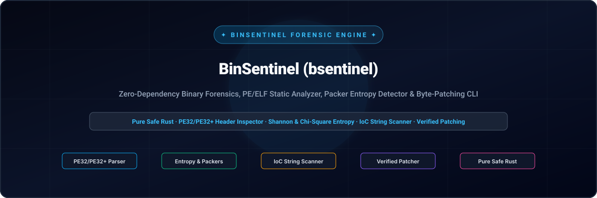
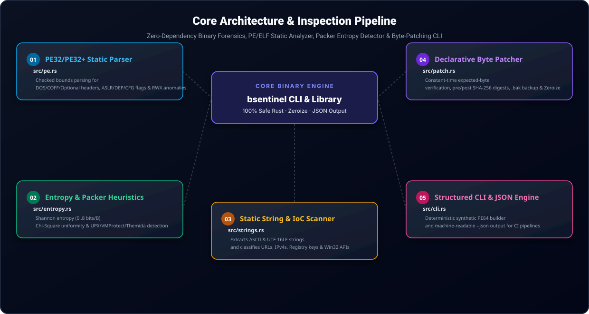

<div align="center">

**🇺🇸 English** · [🇰🇷 한국어](./docs/locales/ko.md) · [🇨🇳 中文](./docs/locales/zh-CN.md) · [🇪🇸 Español](./docs/locales/es.md) · [🇮🇳 हिन्दी](./docs/locales/hi.md) · [🇸🇦 العربية](./docs/locales/ar.md) · [🇧🇷 Português](./docs/locales/pt-BR.md) · [🇷🇺 Русский](./docs/locales/ru.md) · [🇫🇷 Français](./docs/locales/fr.md) · [🇮🇩 Bahasa Indonesia](./docs/locales/id.md)

</div>
<br>

<p align="center">
  
</p>

<div align="center">

# 🛡️ BinSentinel (bsentinel)

**Zero-Dependency Binary Forensics, PE/ELF Static Analyzer, Packer Entropy Detector & Byte-Patching CLI**

[](https://github.com/GHSFS/bin-sentinel/actions/workflows/ci.yml)
[](./LICENSE)
[](./SECURITY.md)
[](./ROADMAP.md)

</div>

---

## 🔍 Overview

<details open>
<summary><b>🔍 Overview</b></summary>
<br>

bin-sentinel (bsentinel) is a single-binary static executable analysis, reverse-engineering triage, and declarative byte-patching toolkit written in 100% safe Rust. Built for security analysts, malware researchers, and systems engineers who need fast, deterministic binary inspection without heavy external runtime dependencies.

</details>

---

## 🏛️ Core Architecture & Inspection Pipeline

<details open>
<summary><b>🏛️ Core Architecture & Inspection Pipeline</b></summary>
<br>

<p align="center">
  
</p>

| # | Module | Source File | Key Capability & Security Invariant |
|---|---|---|---|
| **01** | **PE32/PE32+ Static Parser** | `src/pe.rs` | Checked bounds parsing for DOS/COFF/Optional headers, ASLR/DEP/CFG flags & RWX anomalies |
| **02** | **Entropy & Packer Heuristics** | `src/entropy.rs` | Shannon entropy (0..8 bits/B), Chi-Square uniformity & UPX/VMProtect/Themida detection |
| **03** | **Static String & IoC Scanner** | `src/strings.rs` | Extracts ASCII & UTF-16LE strings and classifies URLs, IPv4s, Registry keys & Win32 APIs |
| **04** | **Declarative Byte Patcher** | `src/patch.rs` | Constant-time expected-byte verification, pre/post SHA-256 digests, .bak backup & Zeroize |
| **05** | **Structured CLI & JSON Engine** | `src/cli.rs` | Deterministic synthetic PE64 builder and machine-readable --json output for CI pipelines |

</details>

---

## ⚡ Quick Start & CLI Usage

<details open>
<summary><b>⚡ Quick Start & CLI Usage</b></summary>
<br>

```bash
# 1. Build release binary
cargo build --release

# 2. Generate a deterministic synthetic PE32+ (64-bit) test binary
bsentinel synth-pe sample.exe

# 3. Inspect PE headers, ASLR/DEP/CFG mitigations, section table & packer heuristics
bsentinel inspect sample.exe
bsentinel inspect sample.exe --json

# 4. Run statistical Shannon entropy & Chi-square uniformity analysis
bsentinel entropy sample.exe --window 512
bsentinel entropy sample.exe --window 512 --json

# 5. Extract printable ASCII & UTF-16LE strings and filter Indicators of Compromise (IoCs)
bsentinel strings sample.exe --min-len 4
bsentinel strings sample.exe --ioc-only --json

# 6. Apply a verified declarative byte patch with expected-byte check and .bak backup
bsentinel patch sample.exe --offset 0x200 --expect 4883EC28 --replace 90909090 --backup --json
```

</details>

---

## 📦 Repository Structure

<details open>
<summary><b>📦 Repository Structure</b></summary>
<br>

```text
bin-sentinel/
├── Cargo.toml                     # Pure-Rust package manifest (bsentinel binary + bin_sentinel lib)
├── README.md                      # Root English documentation with 10-language navigation
├── ROADMAP.md                     # Public engineering roadmap
├── CHANGELOG.md                   # Keep-a-Changelog release history
├── SECURITY.md                    # Binary parsing & memory safety policy
├── LICENSE                        # Apache License 2.0
├── NOTICE                         # Attribution notice owned by GHSFS
├── src/
│   ├── lib.rs                     # Library module exports
│   ├── main.rs                    # CLI entry point & human/JSON output formatting
│   ├── cli.rs                     # Clap derive subcommands (inspect, entropy, strings, patch, synth-pe)
│   ├── error.rs                   # Unified SentinelError & Result<T>
│   ├── pe.rs                      # Zero-dependency PE32/PE32+ header & section parser + synthetic PE64 builder
│   ├── entropy.rs                 # Shannon entropy, Chi-Square uniformity & packer heuristic detector
│   ├── strings.rs                 # ASCII & UTF-16LE string extractor + IoC classifier
│   └── patch.rs                   # Constant-time verified byte patching engine with SHA-256 & Zeroize
├── tests/
│   ├── pe_entropy_test.rs         # Integration tests for PE64 parsing, mitigations, entropy & CLI JSON
│   └── patch_strings_test.rs      # Integration tests for IoC extraction, verified patching & backups
└── docs/
    ├── locales/                   # Localized READMEs (ko, zh-CN, es, hi, ar, pt-BR, ru, fr, id)
    └── assets/locales/            # Localized self-hosted SVG banners & architecture diagrams
```

</details>

---

## 🔒 Memory Safety & Security Invariants

<details open>
<summary><b>🔒 Memory Safety & Security Invariants</b></summary>
<br>

- 🛡️ Zero unsafe blocks across all binary header parsers: every offset and slice read uses checked arithmetic.
- 🛡️ Constant-time byte verification (constant_time_eq) prior to applying any binary patch, aborting with PatchMismatch on drift.
- 🛡️ Full cryptographic audit trail: computes and reports pre-patch and post-patch SHA-256 digests alongside optional .bak backups.
- 🛡️ Proactive memory wiping via zeroize on mutable binary patch buffers.

</details>

---

## 📄 License & Attribution

<details open>
<summary><b>📄 License & Attribution</b></summary>
<br>

Licensed under the Apache License, Version 2.0 with NOTICE attribution file. Owned by GHSFS.

```text
Copyright 2026 GHSFS (https://github.com/GHSFS)

Licensed under the Apache License, Version 2.0 (the "License");
you may not use this file except in compliance with the License.
You may obtain a copy of the License at

    http://www.apache.org/licenses/LICENSE-2.0
```

</details>
