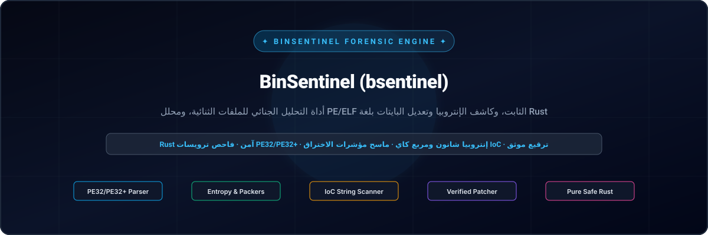
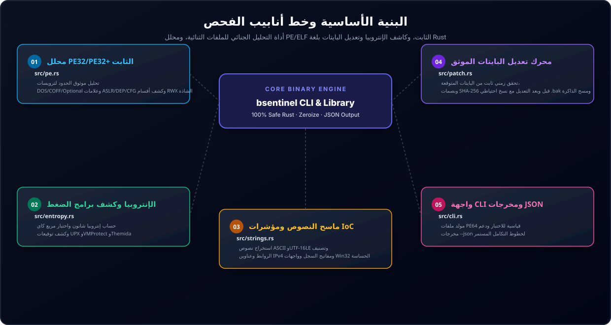

<div align="center">

<p align="center">
  <a href="../../README.md">🇺🇸 English</a> · <a href="./ko.md">🇰🇷 한국어</a> · <a href="./zh-CN.md">🇨🇳 中文</a> · <a href="./es.md">🇪🇸 Español</a> · <a href="./hi.md">🇮🇳 हिन्दी</a><br />
  <strong>🇸🇦 العربية</strong> · <a href="./pt-BR.md">🇧🇷 Português</a> · <a href="./ru.md">🇷🇺 Русский</a> · <a href="./fr.md">🇫🇷 Français</a> · <a href="./id.md">🇮🇩 Bahasa Indonesia</a>
</p>

<p align="center">
  
</p>

<div align="center">

# 🛡️ BinSentinel (bsentinel)

**أداة التحليل الجنائي للملفات الثنائية، ومحلل PE/ELF الثابت، وكاشف الإنتروبيا وتعديل البايتات بلغة Rust**

[](https://github.com/GHSFS/bin-sentinel/actions/workflows/ci.yml)
[](../../LICENSE)
[](../../SECURITY.md)
[](../../ROADMAP.md)

</div>

---

## 🔍 نظرة عامة

<details open>
<summary><b>🔍 نظرة عامة</b></summary>
<br>

أداة bin-sentinel (bsentinel) هي حزمة سطر أوامر مستقلة مكتوبة بالكامل بلغة Rust الآمنة لتحليل الملفات التنفيذية الثابتة، وفرز الهندسة العكسية، وتطبيق التعديلات الثنائية الموثقة بدقة عالية ودون أي اعتماديات خارجية.

</details>

---

## 🏛️ البنية الأساسية وخط أنابيب الفحص

<details open>
<summary><b>🏛️ البنية الأساسية وخط أنابيب الفحص</b></summary>
<br>

<p align="center">
  
</p>

| # | الوحدة | ملف المصدر | القدرة الأساسية وضمانات الأمان |
|---|---|---|---|
| **01** | **محلل PE32/PE32+ الثابت** | `src/pe.rs` | تحليل موثوق الحدود لترويسات DOS/COFF/Optional وعلامات ASLR/DEP/CFG وكشف أقسام RWX الشاذة |
| **02** | **الإنتروبيا وكشف برامج الضغط** | `src/entropy.rs` | حساب إنتروبيا شانون واختبار مربع كاي وكشف توقيعات UPX وVMProtect وThemida |
| **03** | **ماسح النصوص ومؤشرات IoC** | `src/strings.rs` | استخراج نصوص ASCII وUTF-16LE وتصنيف الروابط وعناوين IPv4 ومفاتيح السجل وواجهات Win32 الحساسة |
| **04** | **محرك تعديل البايتات الموثق** | `src/patch.rs` | تحقق زمني ثابت من البايتات المتوقعة، وبصمات SHA-256 قبل وبعد التعديل مع نسخ احتياطي .bak ومسح الذاكرة |
| **05** | **واجهة CLI ومخرجات JSON** | `src/cli.rs` | مولد ملفات PE64 قياسية للاختبار ودعم مخرجات --json لخطوط التكامل المستمر |

</details>

---

## ⚡ البدء السريع واستخدام الأوامر

<details open>
<summary><b>⚡ البدء السريع واستخدام الأوامر</b></summary>
<br>

```bash
# 1. Build release binary
cargo build --release

# 2. Generate a deterministic synthetic PE32+ (64-bit) test binary
bsentinel synth-pe sample.exe

# 3. Inspect PE headers, ASLR/DEP/CFG mitigations, section table & packer heuristics
bsentinel inspect sample.exe
bsentinel inspect sample.exe --json

# 4. Generate and inspect a deterministic synthetic Linux/BSD ELF64 binary
bsentinel synth-elf sample.elf
bsentinel inspect-elf sample.elf
bsentinel inspect-elf sample.elf --json

# 5. Run statistical Shannon entropy & Chi-square uniformity analysis
bsentinel entropy sample.exe --window 512
bsentinel entropy sample.exe --window 512 --json

# 6. Extract printable ASCII & UTF-16LE strings and filter Indicators of Compromise (IoCs)
bsentinel strings sample.exe --min-len 4
bsentinel strings sample.exe --ioc-only --json

# 7. Scan binary for embedded cryptographic constants, AES S-Boxes, SHA/ChaCha20 keys & CRC tables
bsentinel crypto-scan sample.exe
bsentinel crypto-scan sample.exe --json

# 8. Inspect PE Import/Export tables (IAT/EAT), compute imphash & resolve dynamic API hashes
bsentinel imports sample.exe
bsentinel imports sample.exe --resolve-hash 0x0726774C --json

# 9. Apply a verified declarative byte patch with expected-byte check and .bak backup
bsentinel patch sample.exe --offset 0x200 --expect 4883EC28 --replace 90909090 --backup --json

# 10. Scan x86_64 prologues, direct syscalls, RDTSC anti-debug & CPUID checks
bsentinel scan-code sample.exe
bsentinel scan-code sample.exe --json

# 11. Scan declarative YARA-style hex signatures with wildcards, byte jumps & JSON rules
bsentinel rule-scan sample.exe --pattern "48 83 EC ?? [2-6] E8"
bsentinel rule-scan sample.exe --rules rules.json --json

# 12. Compare two binaries structurally and export a declarative JSON patch recipe
bsentinel diff baseline.exe modified.exe --out-recipe patch.json
bsentinel diff baseline.exe modified.exe --json

# 13. Apply or reverse a declarative patch recipe with dry-run verification and backup
bsentinel apply-recipe baseline.exe patch.json --dry-run
bsentinel apply-recipe baseline.exe patch.json --backup
bsentinel apply-recipe baseline.exe patch.json --reverse
```

</details>

---

## 📦 هيكل المستودع

<details open>
<summary><b>📦 هيكل المستودع</b></summary>
<br>

```text
bin-sentinel/
├── Cargo.toml                     # Pure-Rust package manifest (bsentinel binary + bin_sentinel lib)
├── README.md                      # Root English documentation with 10-language navigation
├── ROADMAP.md                     # Public engineering roadmap
├── CHANGELOG.md                   # Keep-a-Changelog release history
├── SECURITY.md                    # Binary parsing & memory safety policy
├── LICENSE                        # Apache License 2.0
├── NOTICE                         # Attribution notice owned by GHSFS
├── src/
│   ├── lib.rs                     # Library module exports
│   ├── main.rs                    # Streamlined CLI entry point dispatching to commands
│   ├── cli.rs                     # Clap derive subcommands (inspect, inspect-elf, imports, crypto-scan, scan-code, rule-scan, etc.)
│   ├── commands/                  # Modular CLI subcommands (inspect, forensics, rules)
│   ├── error.rs                   # Unified SentinelError & Result<T>
│   ├── pe.rs                      # Zero-dependency PE32/PE32+ header & section parser + synthetic PE64 builder
│   ├── elf/                       # Zero-dependency Linux/BSD ELF64 parser (headers, mod, synthetic builder)
│   ├── imports/                   # PE Import/Export (IAT/EAT) parser, RFC 1321 MD5 imphash & dynamic API hash resolver
│   ├── crypto_scan/               # Embedded cryptographic primitives, AES/SM4 S-Boxes & hash constants scanner
│   ├── disasm/                    # x86_64 prologue/epilogue, direct syscalls & control-flow pattern scanner
│   ├── rules/                     # Declarative YARA-style hex signature, nibble wildcard & byte jump scanner
│   ├── entropy.rs                 # Shannon entropy, Chi-Square uniformity & packer heuristic detector
│   ├── strings.rs                 # ASCII & UTF-16LE string extractor + IoC classifier
│   ├── patch.rs                   # Constant-time verified byte patching engine with SHA-256 & Zeroize
│   └── diff/                      # Structural binary diffing & declarative patch recipe engine
├── tests/
│   ├── pe_entropy_test.rs         # Integration tests for PE64 parsing, mitigations, entropy & CLI JSON
│   ├── patch_strings_test.rs      # Integration tests for IoC extraction, verified patching & backups
│   ├── elf_test.rs                # Integration tests for ELF64 parsing, PIE/RELRO/NX mitigations & dynamic symbols
│   ├── crypto_scan_test.rs        # Integration tests for cryptographic constants, S-Boxes & PE/ELF section mapping
│   ├── imports_test.rs            # Integration tests for PE IAT/EAT tables, imphash & dynamic API hash resolution
│   ├── disasm_test.rs             # Integration tests for x86_64 prologues, direct syscalls & anti-debug checks
│   ├── rules_test.rs              # Integration tests for YARA-style hex wildcards, jumps, strings & JSON rule sets
│   └── diff_test.rs               # Integration tests for structural diffing, patch recipes & atomic reversal
└── docs/
    ├── locales/                   # Localized READMEs (ko, zh-CN, es, hi, ar, pt-BR, ru, fr, id)
    └── assets/locales/            # Localized self-hosted SVG banners & architecture diagrams
```

</details>

---

## 🔒 سلامة الذاكرة وضمانات الأمان

<details open>
<summary><b>🔒 سلامة الذاكرة وضمانات الأمان</b></summary>
<br>

- 🛡️ خلو كامل من كتل unsafe في جميع محللات الترويسات مع فحص صارم للحدود.
- 🛡️ مقارنة البايتات المتوقعة بزمن ثابت (constant_time_eq) قبل كتابة أي تعديل.
- 🛡️ توثيق كامل عبر بصمات SHA-256 قبل التعديل وبعده مع دعم النسخ الاحتياطي التلقائي.
- 🛡️ تصفير المخازن المؤقتة الحساسة في الذاكرة فور انتهاء العملية باستخدام zeroize.

</details>

---

## 📄 الترخيص وحقوق الملكية

<details open>
<summary><b>📄 الترخيص وحقوق الملكية</b></summary>
<br>

مرخص بموجب Apache License 2.0 مع ملف NOTICE. مملوك لـ GHSFS.

```text
Copyright 2026 GHSFS (https://github.com/GHSFS)

Licensed under the Apache License, Version 2.0 (the "License");
you may not use this file except in compliance with the License.
You may obtain a copy of the License at

    http://www.apache.org/licenses/LICENSE-2.0
```

</details>
