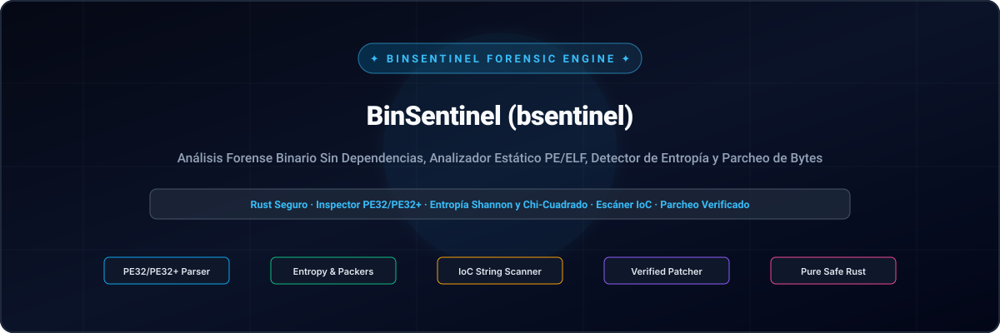
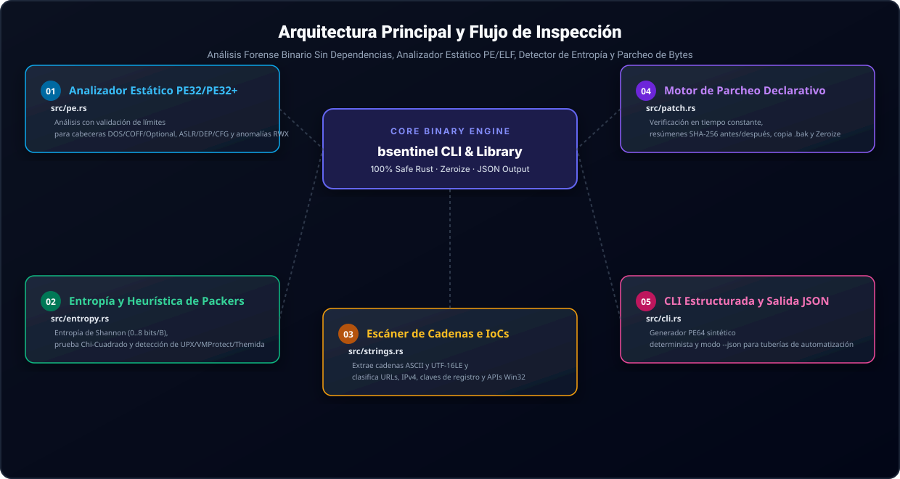

<div align="center">

<p align="center">
  <a href="../../README.md">🇺🇸 English</a> · <a href="./ko.md">🇰🇷 한국어</a> · <a href="./zh-CN.md">🇨🇳 中文</a> · <strong>🇪🇸 Español</strong> · <a href="./hi.md">🇮🇳 हिन्दी</a><br />
  <a href="./ar.md">🇸🇦 العربية</a> · <a href="./pt-BR.md">🇧🇷 Português</a> · <a href="./ru.md">🇷🇺 Русский</a> · <a href="./fr.md">🇫🇷 Français</a> · <a href="./id.md">🇮🇩 Bahasa Indonesia</a>
</p>

<p align="center">
  
</p>

<div align="center">

# 🛡️ BinSentinel (bsentinel)

**Análisis Forense Binario Sin Dependencias, Analizador Estático PE/ELF, Detector de Entropía y Parcheo de Bytes**

[](https://github.com/GHSFS/bin-sentinel/actions/workflows/ci.yml)
[](../../LICENSE)
[](../../SECURITY.md)
[](../../ROADMAP.md)

</div>

---

## 🔍 Descripción General

<details open>
<summary><b>🔍 Descripción General</b></summary>
<br>

bin-sentinel (bsentinel) es una herramienta de línea de comandos en un único binario escrita en Rust seguro para el análisis estático de ejecutables, triaje de ingeniería inversa y aplicación declarativa de parches binarios.

</details>

---

## 🏛️ Arquitectura Principal y Flujo de Inspección

<details open>
<summary><b>🏛️ Arquitectura Principal y Flujo de Inspección</b></summary>
<br>

<p align="center">
  
</p>

| # | Módulo | Archivo Fuente | Capacidad Clave e Invariante de Seguridad |
|---|---|---|---|
| **01** | **Analizador Estático PE32/PE32+** | `src/pe.rs` | Análisis con validación de límites para cabeceras DOS/COFF/Optional, ASLR/DEP/CFG y anomalías RWX |
| **02** | **Entropía y Heurística de Packers** | `src/entropy.rs` | Entropía de Shannon (0..8 bits/B), prueba Chi-Cuadrado y detección de UPX/VMProtect/Themida |
| **03** | **Escáner de Cadenas e IoCs** | `src/strings.rs` | Extrae cadenas ASCII y UTF-16LE y clasifica URLs, IPv4, claves de registro y APIs Win32 |
| **04** | **Motor de Parcheo Declarativo** | `src/patch.rs` | Verificación en tiempo constante, resúmenes SHA-256 antes/después, copia .bak y Zeroize |
| **05** | **CLI Estructurada y Salida JSON** | `src/cli.rs` | Generador PE64 sintético determinista y modo --json para tuberías de automatización |

</details>

---

## ⚡ Inicio Rápido y Uso de CLI

<details open>
<summary><b>⚡ Inicio Rápido y Uso de CLI</b></summary>
<br>

```bash
# 1. Build release binary
cargo build --release

# 2. Generate a deterministic synthetic PE32+ (64-bit) test binary
bsentinel synth-pe sample.exe

# 3. Inspect PE headers, ASLR/DEP/CFG mitigations, section table & packer heuristics
bsentinel inspect sample.exe
bsentinel inspect sample.exe --json

# 4. Generate and inspect a deterministic synthetic Linux/BSD ELF64 binary
bsentinel synth-elf sample.elf
bsentinel inspect-elf sample.elf
bsentinel inspect-elf sample.elf --json

# 5. Run statistical Shannon entropy & Chi-square uniformity analysis
bsentinel entropy sample.exe --window 512
bsentinel entropy sample.exe --window 512 --json

# 6. Extract printable ASCII & UTF-16LE strings and filter Indicators of Compromise (IoCs)
bsentinel strings sample.exe --min-len 4
bsentinel strings sample.exe --ioc-only --json

# 7. Scan binary for embedded cryptographic constants, AES S-Boxes, SHA/ChaCha20 keys & CRC tables
bsentinel crypto-scan sample.exe
bsentinel crypto-scan sample.exe --json

# 8. Inspect PE Import/Export tables (IAT/EAT), compute imphash & resolve dynamic API hashes
bsentinel imports sample.exe
bsentinel imports sample.exe --resolve-hash 0x0726774C --json

# 9. Apply a verified declarative byte patch with expected-byte check and .bak backup
bsentinel patch sample.exe --offset 0x200 --expect 4883EC28 --replace 90909090 --backup --json

# 10. Scan x86_64 prologues, direct syscalls, RDTSC anti-debug & CPUID checks
bsentinel scan-code sample.exe
bsentinel scan-code sample.exe --json

# 11. Scan declarative YARA-style hex signatures with wildcards, byte jumps & JSON rules
bsentinel rule-scan sample.exe --pattern "48 83 EC ?? [2-6] E8"
bsentinel rule-scan sample.exe --rules rules.json --json

# 12. Compare two binaries structurally and export a declarative JSON patch recipe
bsentinel diff baseline.exe modified.exe --out-recipe patch.json
bsentinel diff baseline.exe modified.exe --json

# 13. Apply or reverse a declarative patch recipe with dry-run verification and backup
bsentinel apply-recipe baseline.exe patch.json --dry-run
bsentinel apply-recipe baseline.exe patch.json --backup
bsentinel apply-recipe baseline.exe patch.json --reverse

# 14. Decode PE Rich header, fingerprint Visual Studio toolchains & verify 32-bit checksum
bsentinel rich sample.exe
bsentinel rich sample.exe --json

# 15. Brute-force single/multi-byte XOR, ADD & ROL deobfuscation to uncover hidden IoCs and headers
bsentinel xor-scan sample.exe
bsentinel xor-scan sample.exe --json

# 16. Inspect PE Resource Directory (.rsrc), extract manifest, UAC execution levels & version info
bsentinel resources sample.exe
bsentinel resources sample.exe --json

# 17. Inspect PE TLS callbacks, pre-main execution hooks & x64 exception unwind (.pdata) tables
bsentinel callbacks sample.exe
bsentinel callbacks sample.exe --json
```

</details>

---

## 📦 Estructura del Repositorio

<details open>
<summary><b>📦 Estructura del Repositorio</b></summary>
<br>

```text
bin-sentinel/
├── Cargo.toml                     # Pure-Rust package manifest (bsentinel binary + bin_sentinel lib)
├── README.md                      # Root English documentation with 10-language navigation
├── ROADMAP.md                     # Public engineering roadmap
├── CHANGELOG.md                   # Keep-a-Changelog release history
├── SECURITY.md                    # Binary parsing & memory safety policy
├── LICENSE                        # Apache License 2.0
├── NOTICE                         # Attribution notice owned by GHSFS
├── src/
│   ├── lib.rs                     # Library module exports
│   ├── main.rs                    # Streamlined CLI entry point dispatching to commands
│   ├── cli.rs                     # Clap derive subcommands (inspect, inspect-elf, imports, crypto-scan, scan-code, rule-scan, rich, xor-scan, etc.)
│   ├── commands/                  # Modular CLI subcommands (inspect, forensics, rules, diff, authenticode, macho, rich)
│   ├── error.rs                   # Unified SentinelError & Result<T>
│   ├── pe.rs                      # Zero-dependency PE32/PE32+ header & section parser + synthetic PE64 builder
│   ├── elf/                       # Zero-dependency Linux/BSD ELF64 parser (headers, mod, synthetic builder)
│   ├── imports/                   # PE Import/Export (IAT/EAT) parser, RFC 1321 MD5 imphash & dynamic API hash resolver
│   ├── crypto_scan/               # Embedded cryptographic primitives, AES/SM4 S-Boxes & hash constants scanner
│   ├── disasm/                    # x86_64 prologue/epilogue, direct syscalls & control-flow pattern scanner
│   ├── rules/                     # Declarative YARA-style hex signature, nibble wildcard & byte jump scanner
│   ├── rich/                      # PE Rich header decoder, MSVC compiler toolchain fingerprinter & checksum validator
│   ├── deobfuscate/               # Single/multi-byte XOR, ADD & ROL deobfuscation scanner & key recovery
│   ├── resources/                 # PE 3-level resource directory (.rsrc), application manifest & version info parser
│   ├── callbacks/                 # PE TLS callbacks, pre-main hooks & x64 .pdata exception unwind tables
│   ├── entropy.rs                 # Shannon entropy, Chi-Square uniformity & packer heuristic detector
│   ├── strings.rs                 # ASCII & UTF-16LE string extractor + IoC classifier
│   ├── patch.rs                   # Constant-time verified byte patching engine with SHA-256 & Zeroize
│   └── diff/                      # Structural binary diffing & declarative patch recipe engine
├── tests/
│   ├── pe_entropy_test.rs         # Integration tests for PE64 parsing, mitigations, entropy & CLI JSON
│   ├── patch_strings_test.rs      # Integration tests for IoC extraction, verified patching & backups
│   ├── elf_test.rs                # Integration tests for ELF64 parsing, PIE/RELRO/NX mitigations & dynamic symbols
│   ├── crypto_scan_test.rs        # Integration tests for cryptographic constants, S-Boxes & PE/ELF section mapping
│   ├── imports_test.rs            # Integration tests for PE IAT/EAT tables, imphash & dynamic API hash resolution
│   ├── disasm_test.rs             # Integration tests for x86_64 prologues, direct syscalls & anti-debug checks
│   ├── rules_test.rs              # Integration tests for YARA-style hex wildcards, jumps, strings & JSON rule sets
│   ├── diff_test.rs               # Integration tests for structural diffing, patch recipes & atomic reversal
│   ├── rich_test.rs               # Integration tests for PE Rich header decoding, toolchain fingerprinting & checksums
│   ├── deobfuscate_test.rs        # Integration tests for XOR/ADD/ROL deobfuscation, crib dragging & payload classifiers
│   ├── resources_test.rs          # Integration tests for PE resource directory tree, UAC manifest & version info
│   ├── callbacks_test.rs          # Integration tests for TLS callbacks, pre-main alerts, pdata tables & exception handlers
└── docs/
    ├── locales/                   # Localized READMEs (ko, zh-CN, es, hi, ar, pt-BR, ru, fr, id)
    └── assets/locales/            # Localized self-hosted SVG banners & architecture diagrams
```

</details>

---

## 🔒 Seguridad de Memoria e Invariantes

<details open>
<summary><b>🔒 Seguridad de Memoria e Invariantes</b></summary>
<br>

- 🛡️ Cero bloques unsafe en todos los analizadores binarios; aritmética verificada contra desbordamientos.
- 🛡️ Comparación en tiempo constante (constant_time_eq) antes de modificar cualquier byte en disco.
- 🛡️ Registro criptográfico completo con hashes SHA-256 previos y posteriores al parcheo.
- 🛡️ Limpieza proactiva de memoria mediante zeroize en los búferes de trabajo.

</details>

---

## 📄 Licencia y Atribución

<details open>
<summary><b>📄 Licencia y Atribución</b></summary>
<br>

Publicado bajo Apache License 2.0 con archivo NOTICE. Propiedad de GHSFS.

```text
Copyright 2026 GHSFS (https://github.com/GHSFS)

Licensed under the Apache License, Version 2.0 (the "License");
you may not use this file except in compliance with the License.
You may obtain a copy of the License at

    http://www.apache.org/licenses/LICENSE-2.0
```

</details>
