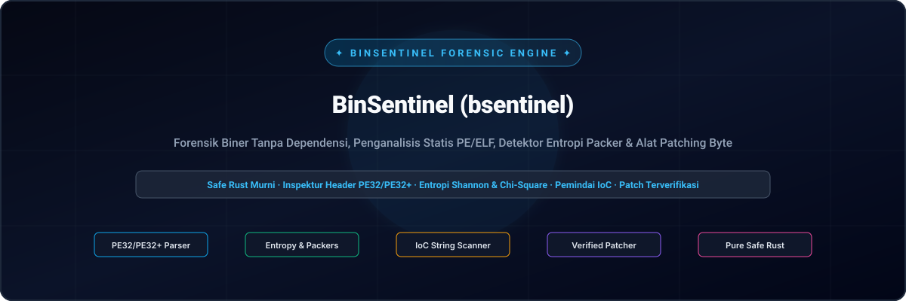
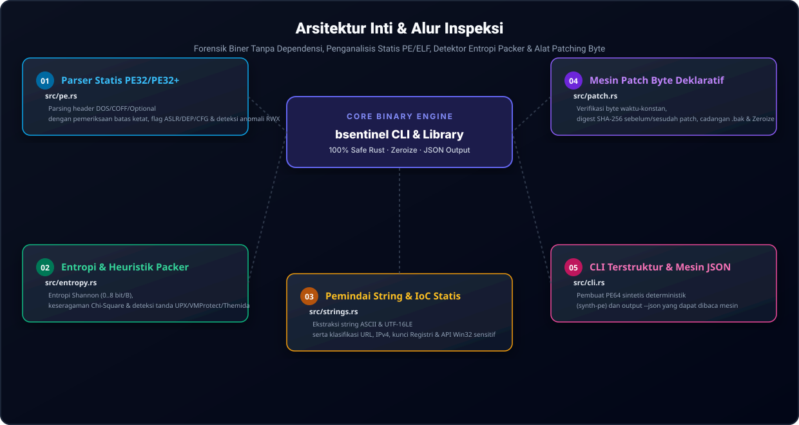

<div align="center">

[🇺🇸 English](../../README.md) · [🇰🇷 한국어](./ko.md) · [🇨🇳 中文](./zh-CN.md) · [🇪🇸 Español](./es.md) · [🇮🇳 हिन्दी](./hi.md) · [🇸🇦 العربية](./ar.md) · [🇧🇷 Português](./pt-BR.md) · [🇷🇺 Русский](./ru.md) · [🇫🇷 Français](./fr.md) · **🇮🇩 Bahasa Indonesia**

</div>
<br>

<p align="center">
  
</p>

<div align="center">

# 🛡️ BinSentinel (bsentinel)

**Forensik Biner Tanpa Dependensi, Penganalisis Statis PE/ELF, Detektor Entropi Packer & Alat Patching Byte**

[](https://github.com/GHSFS/bin-sentinel/actions/workflows/ci.yml)
[](../../LICENSE)
[](../../SECURITY.md)
[](../../ROADMAP.md)

</div>

---

## 🔍 Ringkasan

<details open>
<summary><b>🔍 Ringkasan</b></summary>
<br>

bin-sentinel (bsentinel) adalah perangkat baris perintah biner tunggal yang ditulis dalam 100% safe Rust untuk analisis statis file eksekusi, triase rekayasa balik (reverse engineering), dan penerapan patch byte deklaratif tanpa dependensi runtime eksternal.

</details>

---

## 🏛️ Arsitektur Inti & Alur Inspeksi

<details open>
<summary><b>🏛️ Arsitektur Inti & Alur Inspeksi</b></summary>
<br>

<p align="center">
  
</p>

| # | Modul | File Sumber | Kemampuan Utama & Invarian Keamanan |
|---|---|---|---|
| **01** | **Parser Statis PE32/PE32+** | `src/pe.rs` | Parsing header DOS/COFF/Optional dengan pemeriksaan batas ketat, flag ASLR/DEP/CFG & deteksi anomali RWX |
| **02** | **Entropi & Heuristik Packer** | `src/entropy.rs` | Entropi Shannon (0..8 bit/B), keseragaman Chi-Square & deteksi tanda UPX/VMProtect/Themida |
| **03** | **Pemindai String & IoC Statis** | `src/strings.rs` | Ekstraksi string ASCII & UTF-16LE serta klasifikasi URL, IPv4, kunci Registri & API Win32 sensitif |
| **04** | **Mesin Patch Byte Deklaratif** | `src/patch.rs` | Verifikasi byte waktu-konstan, digest SHA-256 sebelum/sesudah patch, cadangan .bak & Zeroize |
| **05** | **CLI Terstruktur & Mesin JSON** | `src/cli.rs` | Pembuat PE64 sintetis deterministik (synth-pe) dan output --json yang dapat dibaca mesin |

</details>

---

## ⚡ Panduan Cepat & Penggunaan CLI

<details open>
<summary><b>⚡ Panduan Cepat & Penggunaan CLI</b></summary>
<br>

```bash
# 1. Build release binary
cargo build --release

# 2. Generate a deterministic synthetic PE32+ (64-bit) test binary
bsentinel synth-pe sample.exe

# 3. Inspect PE headers, ASLR/DEP/CFG mitigations, section table & packer heuristics
bsentinel inspect sample.exe
bsentinel inspect sample.exe --json

# 4. Run statistical Shannon entropy & Chi-square uniformity analysis
bsentinel entropy sample.exe --window 512
bsentinel entropy sample.exe --window 512 --json

# 5. Extract printable ASCII & UTF-16LE strings and filter Indicators of Compromise (IoCs)
bsentinel strings sample.exe --min-len 4
bsentinel strings sample.exe --ioc-only --json

# 6. Apply a verified declarative byte patch with expected-byte check and .bak backup
bsentinel patch sample.exe --offset 0x200 --expect 4883EC28 --replace 90909090 --backup --json
```

</details>

---

## 📦 Struktur Repositori

<details open>
<summary><b>📦 Struktur Repositori</b></summary>
<br>

```text
bin-sentinel/
├── Cargo.toml                     # Pure-Rust package manifest (bsentinel binary + bin_sentinel lib)
├── README.md                      # Root English documentation with 10-language navigation
├── ROADMAP.md                     # Public engineering roadmap
├── CHANGELOG.md                   # Keep-a-Changelog release history
├── SECURITY.md                    # Binary parsing & memory safety policy
├── LICENSE                        # Apache License 2.0
├── NOTICE                         # Attribution notice owned by GHSFS
├── src/
│   ├── lib.rs                     # Library module exports
│   ├── main.rs                    # CLI entry point & human/JSON output formatting
│   ├── cli.rs                     # Clap derive subcommands (inspect, entropy, strings, patch, synth-pe)
│   ├── error.rs                   # Unified SentinelError & Result<T>
│   ├── pe.rs                      # Zero-dependency PE32/PE32+ header & section parser + synthetic PE64 builder
│   ├── entropy.rs                 # Shannon entropy, Chi-Square uniformity & packer heuristic detector
│   ├── strings.rs                 # ASCII & UTF-16LE string extractor + IoC classifier
│   └── patch.rs                   # Constant-time verified byte patching engine with SHA-256 & Zeroize
├── tests/
│   ├── pe_entropy_test.rs         # Integration tests for PE64 parsing, mitigations, entropy & CLI JSON
│   └── patch_strings_test.rs      # Integration tests for IoC extraction, verified patching & backups
└── docs/
    ├── locales/                   # Localized READMEs (ko, zh-CN, es, hi, ar, pt-BR, ru, fr, id)
    └── assets/locales/            # Localized self-hosted SVG banners & architecture diagrams
```

</details>

---

## 🔒 Keamanan Memori & Invarian Keamanan

<details open>
<summary><b>🔒 Keamanan Memori & Invarian Keamanan</b></summary>
<br>

- 🛡️ Nol blok unsafe di seluruh parser header biner; setiap pembacaan offset memeriksa batas ukuran file.
- 🛡️ Verifikasi byte yang diharapkan dalam waktu-konstan (constant_time_eq) sebelum menerapkan patch.
- 🛡️ Jejak audit kriptografi lengkap dengan hash SHA-256 sebelum dan sesudah patch serta opsi file cadangan .bak.
- 🛡️ Pembersihan memori proaktif melalui zeroize pada buffer patch.

</details>

---

## 📄 Lisensi & Atribusi

<details open>
<summary><b>📄 Lisensi & Atribusi</b></summary>
<br>

Dilisensikan di bawah Apache License 2.0 dengan file atribusi NOTICE. Dimiliki oleh GHSFS.

```text
Copyright 2026 GHSFS (https://github.com/GHSFS)

Licensed under the Apache License, Version 2.0 (the "License");
you may not use this file except in compliance with the License.
You may obtain a copy of the License at

    http://www.apache.org/licenses/LICENSE-2.0
```

</details>
