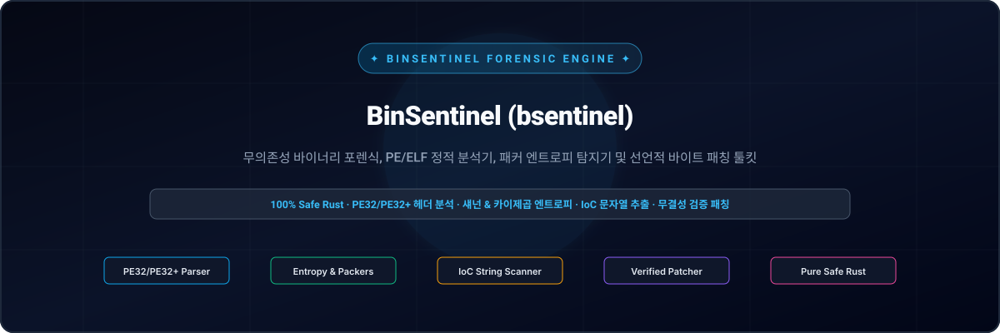
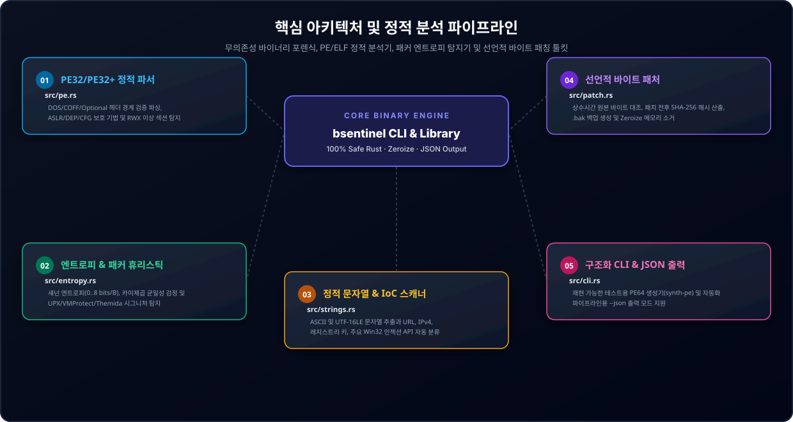

<div align="center">

<p align="center">
  <a href="../../README.md">🇺🇸 English</a> · <strong>🇰🇷 한국어</strong> · <a href="./zh-CN.md">🇨🇳 中文</a> · <a href="./es.md">🇪🇸 Español</a> · <a href="./hi.md">🇮🇳 हिन्दी</a><br />
  <a href="./ar.md">🇸🇦 العربية</a> · <a href="./pt-BR.md">🇧🇷 Português</a> · <a href="./ru.md">🇷🇺 Русский</a> · <a href="./fr.md">🇫🇷 Français</a> · <a href="./id.md">🇮🇩 Bahasa Indonesia</a>
</p>

<p align="center">
  
</p>

<div align="center">

# 🛡️ BinSentinel (bsentinel)

**무의존성 바이너리 포렌식, PE/ELF 정적 분석기, 패커 엔트로피 탐지기 및 선언적 바이트 패칭 툴킷**

[](https://github.com/GHSFS/bin-sentinel/actions/workflows/ci.yml)
[](../../LICENSE)
[](../../SECURITY.md)
[](../../ROADMAP.md)

</div>

---

## 🔍 개요

<details open>
<summary><b>🔍 개요</b></summary>
<br>

bin-sentinel(bsentinel)은 외부 런타임 의존성 없이 동작하는 순수 Rust 기반 단일 바이너리 정적 실행 파일 분석, 리버스 엔지니어링 초기 분류(Triage) 및 선언적 바이트 패칭 도구입니다. 보안 분석가와 시스템 엔지니어가 비신뢰 바이너리를 안전하고 빠르게 검사할 수 있도록 설계되었습니다.

</details>

---

## 🏛️ 핵심 아키텍처 및 정적 분석 파이프라인

<details open>
<summary><b>🏛️ 핵심 아키텍처 및 정적 분석 파이프라인</b></summary>
<br>

<p align="center">
  
</p>

| # | 모듈명 | 소스 경로 | 핵심 기능 및 보안 불변식 |
|---|---|---|---|
| **01** | **PE32/PE32+ 정적 파서** | `src/pe.rs` | DOS/COFF/Optional 헤더 경계 검증 파싱, ASLR/DEP/CFG 보호 기법 및 RWX 이상 섹션 탐지 |
| **02** | **엔트로피 & 패커 휴리스틱** | `src/entropy.rs` | 섀넌 엔트로피(0..8 bits/B), 카이제곱 균일성 검정 및 UPX/VMProtect/Themida 시그니처 탐지 |
| **03** | **정적 문자열 & IoC 스캐너** | `src/strings.rs` | ASCII 및 UTF-16LE 문자열 추출과 URL, IPv4, 레지스트리 키, 주요 Win32 인젝션 API 자동 분류 |
| **04** | **선언적 바이트 패처** | `src/patch.rs` | 상수시간 원본 바이트 대조, 패치 전후 SHA-256 해시 산출, .bak 백업 생성 및 Zeroize 메모리 소거 |
| **05** | **구조화 CLI & JSON 출력** | `src/cli.rs` | 재현 가능한 테스트용 PE64 생성기(synth-pe) 및 자동화 파이프라인용 --json 출력 모드 지원 |

</details>

---

## ⚡ 빠른 시작 및 CLI 사용법

<details open>
<summary><b>⚡ 빠른 시작 및 CLI 사용법</b></summary>
<br>

```bash
# 1. Build release binary
cargo build --release

# 2. Generate a deterministic synthetic PE32+ (64-bit) test binary
bsentinel synth-pe sample.exe

# 3. Inspect PE headers, ASLR/DEP/CFG mitigations, section table & packer heuristics
bsentinel inspect sample.exe
bsentinel inspect sample.exe --json

# 4. Generate and inspect a deterministic synthetic Linux/BSD ELF64 binary
bsentinel synth-elf sample.elf
bsentinel inspect-elf sample.elf
bsentinel inspect-elf sample.elf --json

# 5. Run statistical Shannon entropy & Chi-square uniformity analysis
bsentinel entropy sample.exe --window 512
bsentinel entropy sample.exe --window 512 --json

# 6. Extract printable ASCII & UTF-16LE strings and filter Indicators of Compromise (IoCs)
bsentinel strings sample.exe --min-len 4
bsentinel strings sample.exe --ioc-only --json

# 7. Scan binary for embedded cryptographic constants, AES S-Boxes, SHA/ChaCha20 keys & CRC tables
bsentinel crypto-scan sample.exe
bsentinel crypto-scan sample.exe --json

# 8. Apply a verified declarative byte patch with expected-byte check and .bak backup
bsentinel patch sample.exe --offset 0x200 --expect 4883EC28 --replace 90909090 --backup --json
```

</details>

---

## 📦 저장소 디렉터리 구조

<details open>
<summary><b>📦 저장소 디렉터리 구조</b></summary>
<br>

```text
bin-sentinel/
├── Cargo.toml                     # Pure-Rust package manifest (bsentinel binary + bin_sentinel lib)
├── README.md                      # Root English documentation with 10-language navigation
├── ROADMAP.md                     # Public engineering roadmap
├── CHANGELOG.md                   # Keep-a-Changelog release history
├── SECURITY.md                    # Binary parsing & memory safety policy
├── LICENSE                        # Apache License 2.0
├── NOTICE                         # Attribution notice owned by GHSFS
├── src/
│   ├── lib.rs                     # Library module exports
│   ├── main.rs                    # CLI entry point & human/JSON output formatting
│   ├── cli.rs                     # Clap derive subcommands (inspect, inspect-elf, crypto-scan, entropy, strings, patch)
│   ├── error.rs                   # Unified SentinelError & Result<T>
│   ├── pe.rs                      # Zero-dependency PE32/PE32+ header & section parser + synthetic PE64 builder
│   ├── elf/                       # Zero-dependency Linux/BSD ELF64 parser (headers, mod, synthetic builder)
│   ├── crypto_scan/               # Embedded cryptographic primitives, AES/SM4 S-Boxes & hash constants scanner
│   ├── entropy.rs                 # Shannon entropy, Chi-Square uniformity & packer heuristic detector
│   ├── strings.rs                 # ASCII & UTF-16LE string extractor + IoC classifier
│   └── patch.rs                   # Constant-time verified byte patching engine with SHA-256 & Zeroize
├── tests/
│   ├── pe_entropy_test.rs         # Integration tests for PE64 parsing, mitigations, entropy & CLI JSON
│   ├── patch_strings_test.rs      # Integration tests for IoC extraction, verified patching & backups
│   ├── elf_test.rs                # Integration tests for ELF64 parsing, PIE/RELRO/NX mitigations & dynamic symbols
│   └── crypto_scan_test.rs        # Integration tests for cryptographic constants, S-Boxes & PE/ELF section mapping
└── docs/
    ├── locales/                   # Localized READMEs (ko, zh-CN, es, hi, ar, pt-BR, ru, fr, id)
    └── assets/locales/            # Localized self-hosted SVG banners & architecture diagrams
```

</details>

---

## 🔒 메모리 안전성 및 보안 원칙

<details open>
<summary><b>🔒 메모리 안전성 및 보안 원칙</b></summary>
<br>

- 🛡️ 모든 바이너리 파서에서 unsafe 블록을 배제하고 오프셋 오버플로우 및 슬라이스 경계 검사를 수행합니다.
- 🛡️ 바이트 패치 적용 전 원본 바이트를 상수시간(constant_time_eq)으로 대조하여 불일치 시 즉시 작업을 중단합니다.
- 🛡️ 패치 전후 전체 파일의 SHA-256 해시를 계산하여 출력하며, 선택적 .bak 원본 백업을 지원합니다.
- 🛡️ 패치 작업에 사용된 가변 버퍼는 작업 직후 zeroize를 통해 메모리에서 안전하게 소거합니다.

</details>

---

## 📄 라이선스 및 저작권 고지

<details open>
<summary><b>📄 라이선스 및 저작권 고지</b></summary>
<br>

Apache License 2.0 및 NOTICE 고지 하에 배포되며 GHSFS가 저작권을 소유합니다.

```text
Copyright 2026 GHSFS (https://github.com/GHSFS)

Licensed under the Apache License, Version 2.0 (the "License");
you may not use this file except in compliance with the License.
You may obtain a copy of the License at

    http://www.apache.org/licenses/LICENSE-2.0
```

</details>
