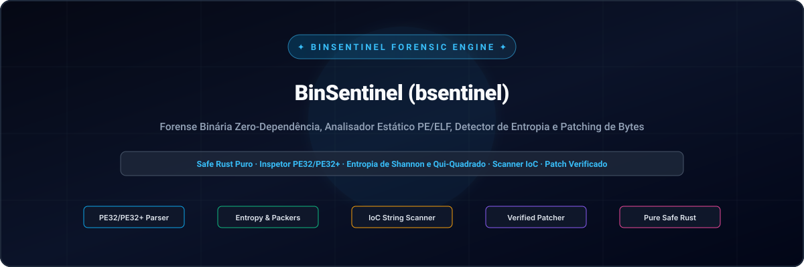
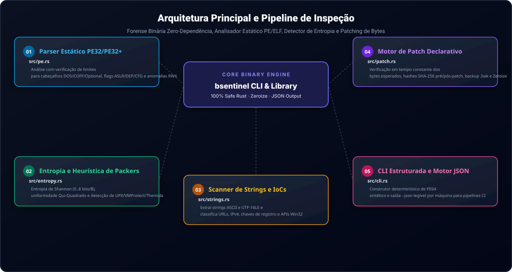

<div align="center">

<p align="center">
  <a href="../../README.md">🇺🇸 English</a> · <a href="./ko.md">🇰🇷 한국어</a> · <a href="./zh-CN.md">🇨🇳 中文</a> · <a href="./es.md">🇪🇸 Español</a> · <a href="./hi.md">🇮🇳 हिन्दी</a><br />
  <a href="./ar.md">🇸🇦 العربية</a> · <strong>🇧🇷 Português</strong> · <a href="./ru.md">🇷🇺 Русский</a> · <a href="./fr.md">🇫🇷 Français</a> · <a href="./id.md">🇮🇩 Bahasa Indonesia</a>
</p>

<p align="center">
  
</p>

<div align="center">

# 🛡️ BinSentinel (bsentinel)

**Forense Binária Zero-Dependência, Analisador Estático PE/ELF, Detector de Entropia e Patching de Bytes**

[](https://github.com/GHSFS/bin-sentinel/actions/workflows/ci.yml)
[](../../LICENSE)
[](../../SECURITY.md)
[](../../ROADMAP.md)

</div>

---

## 🔍 Visão Geral

<details open>
<summary><b>🔍 Visão Geral</b></summary>
<br>

O bin-sentinel (bsentinel) é um kit de ferramentas de linha de comando em binário único escrito em Rust 100% seguro para análise estática de executáveis, triagem de engenharia reversa e aplicação declarativa de patches de bytes.

</details>

---

## 🏛️ Arquitetura Principal e Pipeline de Inspeção

<details open>
<summary><b>🏛️ Arquitetura Principal e Pipeline de Inspeção</b></summary>
<br>

<p align="center">
  
</p>

| # | Módulo | Arquivo Fonte | Capacidade Principal e Invariante de Segurança |
|---|---|---|---|
| **01** | **Parser Estático PE32/PE32+** | `src/pe.rs` | Análise com verificação de limites para cabeçalhos DOS/COFF/Optional, flags ASLR/DEP/CFG e anomalias RWX |
| **02** | **Entropia e Heurística de Packers** | `src/entropy.rs` | Entropia de Shannon (0..8 bits/B), uniformidade Qui-Quadrado e detecção de UPX/VMProtect/Themida |
| **03** | **Scanner de Strings e IoCs** | `src/strings.rs` | Extrai strings ASCII e UTF-16LE e classifica URLs, IPv4, chaves de registro e APIs Win32 |
| **04** | **Motor de Patch Declarativo** | `src/patch.rs` | Verificação em tempo constante dos bytes esperados, hashes SHA-256 pré/pós-patch, backup .bak e Zeroize |
| **05** | **CLI Estruturada e Motor JSON** | `src/cli.rs` | Construtor determinístico de PE64 sintético e saída --json legível por máquina para pipelines CI |

</details>

---

## ⚡ Início Rápido e Uso da CLI

<details open>
<summary><b>⚡ Início Rápido e Uso da CLI</b></summary>
<br>

```bash
# 1. Build release binary
cargo build --release

# 2. Generate a deterministic synthetic PE32+ (64-bit) test binary
bsentinel synth-pe sample.exe

# 3. Inspect PE headers, ASLR/DEP/CFG mitigations, section table & packer heuristics
bsentinel inspect sample.exe
bsentinel inspect sample.exe --json

# 4. Generate and inspect a deterministic synthetic Linux/BSD ELF64 binary
bsentinel synth-elf sample.elf
bsentinel inspect-elf sample.elf
bsentinel inspect-elf sample.elf --json

# 5. Run statistical Shannon entropy & Chi-square uniformity analysis
bsentinel entropy sample.exe --window 512
bsentinel entropy sample.exe --window 512 --json

# 6. Extract printable ASCII & UTF-16LE strings and filter Indicators of Compromise (IoCs)
bsentinel strings sample.exe --min-len 4
bsentinel strings sample.exe --ioc-only --json

# 7. Apply a verified declarative byte patch with expected-byte check and .bak backup
bsentinel patch sample.exe --offset 0x200 --expect 4883EC28 --replace 90909090 --backup --json
```

</details>

---

## 📦 Estrutura do Repositório

<details open>
<summary><b>📦 Estrutura do Repositório</b></summary>
<br>

```text
bin-sentinel/
├── Cargo.toml                     # Pure-Rust package manifest (bsentinel binary + bin_sentinel lib)
├── README.md                      # Root English documentation with 10-language navigation
├── ROADMAP.md                     # Public engineering roadmap
├── CHANGELOG.md                   # Keep-a-Changelog release history
├── SECURITY.md                    # Binary parsing & memory safety policy
├── LICENSE                        # Apache License 2.0
├── NOTICE                         # Attribution notice owned by GHSFS
├── src/
│   ├── lib.rs                     # Library module exports
│   ├── main.rs                    # CLI entry point & human/JSON output formatting
│   ├── cli.rs                     # Clap derive subcommands (inspect, inspect-elf, entropy, strings, patch, synth-pe, synth-elf)
│   ├── error.rs                   # Unified SentinelError & Result<T>
│   ├── pe.rs                      # Zero-dependency PE32/PE32+ header & section parser + synthetic PE64 builder
│   ├── elf/                       # Zero-dependency Linux/BSD ELF64 parser (headers, mod, synthetic builder)
│   ├── entropy.rs                 # Shannon entropy, Chi-Square uniformity & packer heuristic detector
│   ├── strings.rs                 # ASCII & UTF-16LE string extractor + IoC classifier
│   └── patch.rs                   # Constant-time verified byte patching engine with SHA-256 & Zeroize
├── tests/
│   ├── pe_entropy_test.rs         # Integration tests for PE64 parsing, mitigations, entropy & CLI JSON
│   ├── patch_strings_test.rs      # Integration tests for IoC extraction, verified patching & backups
│   └── elf_test.rs                # Integration tests for ELF64 parsing, PIE/RELRO/NX mitigations & dynamic symbols
└── docs/
    ├── locales/                   # Localized READMEs (ko, zh-CN, es, hi, ar, pt-BR, ru, fr, id)
    └── assets/locales/            # Localized self-hosted SVG banners & architecture diagrams
```

</details>

---

## 🔒 Segurança de Memória e Garantias

<details open>
<summary><b>🔒 Segurança de Memória e Garantias</b></summary>
<br>

- 🛡️ Zero blocos unsafe em todos os analisadores binários; leituras verificadas contra overflow.
- 🛡️ Comparação de bytes em tempo constante (constant_time_eq) antes de aplicar qualquer modificação.
- 🛡️ Trilha de auditoria criptográfica com resumos SHA-256 antes e depois do patch.
- 🛡️ Limpeza imediata de buffers de trabalho na memória via zeroize.

</details>

---

## 📄 Licença e Atribuição

<details open>
<summary><b>📄 Licença e Atribuição</b></summary>
<br>

Licenciado sob a Apache License 2.0 com arquivo NOTICE. Propriedade de GHSFS.

```text
Copyright 2026 GHSFS (https://github.com/GHSFS)

Licensed under the Apache License, Version 2.0 (the "License");
you may not use this file except in compliance with the License.
You may obtain a copy of the License at

    http://www.apache.org/licenses/LICENSE-2.0
```

</details>
