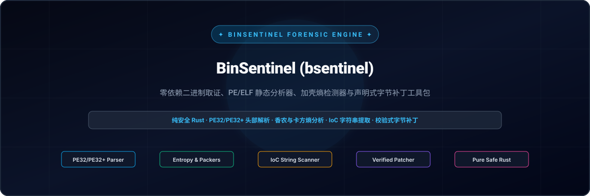
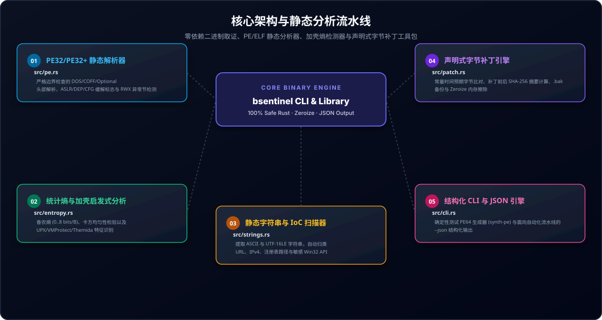

<div align="center">

<p align="center">
  <a href="../../README.md">🇺🇸 English</a> · <a href="./ko.md">🇰🇷 한국어</a> · <strong>🇨🇳 中文</strong> · <a href="./es.md">🇪🇸 Español</a> · <a href="./hi.md">🇮🇳 हिन्दी</a><br />
  <a href="./ar.md">🇸🇦 العربية</a> · <a href="./pt-BR.md">🇧🇷 Português</a> · <a href="./ru.md">🇷🇺 Русский</a> · <a href="./fr.md">🇫🇷 Français</a> · <a href="./id.md">🇮🇩 Bahasa Indonesia</a>
</p>

<p align="center">
  
</p>

<div align="center">

# 🛡️ BinSentinel (bsentinel)

**零外部依赖二进制取证、PE/ELF 静态分析器、壳特征与熵值检测器及声明式字节补丁工具包**

[](https://github.com/GHSFS/bin-sentinel/actions/workflows/ci.yml)
[](../../LICENSE)
[](../../SECURITY.md)
[](../../ROADMAP.md)

</div>

---

## 🔍 项目概述

<details open>
<summary><b>🔍 项目概述</b></summary>
<br>

bin-sentinel (bsentinel) 是一款基于 100% 内存安全 Rust 构建的单二进制静态可执行文件分析、逆向工程分诊与声明式字节补丁工具集。专为需要快速、确定性地审查不可信二进制文件且无需庞大外部运行时依赖的安全分析师、恶意软件研究员及系统工程师量身打造。

</details>

---

## 🏛️ 核心架构与检测分析流水线

<details open>
<summary><b>🏛️ 核心架构与检测分析流水线</b></summary>
<br>

<p align="center">
  
</p>

| # | 模块名称 | 源码文件 | 核心能力与安全不变量 |
|---|---|---|---|
| **01** | **PE32/PE32+ 静态解析器** | `src/pe.rs` | 严格边界检查解析 DOS/COFF/Optional 头部、ASLR/DEP/CFG 缓解机制及 RWX 异常内存段 |
| **02** | **信息熵与加壳特征分析** | `src/entropy.rs` | 香农熵计算（0..8 bits/B）、卡方均匀性检验及 UPX/VMProtect/Themida 特征识别 |
| **03** | **静态字符串与 IoC 扫描器** | `src/strings.rs` | 提取 ASCII 及 UTF-16LE 字符串，自动分类 URL、IPv4、注册表键值及主要 Win32 敏感 API |
| **04** | **声明式字节补丁引擎** | `src/patch.rs` | 常数时间原始字节校验、补丁前后 SHA-256 哈希比对、自动生成 .bak 备份及 Zeroize 内存擦除 |
| **05** | **结构化 CLI 与 JSON 引擎** | `src/cli.rs` | 确定性生成测试用 PE64 文件（synth-pe），提供面向 CI 自动化流水线的 --json 机器可读输出 |

</details>

---

## ⚡ 快速上手与 CLI 命令行用法

<details open>
<summary><b>⚡ 快速上手与 CLI 命令行用法</b></summary>
<br>

```bash
# 1. 编译发布版本二进制程序
cargo build --release

# 2. 生成确定性合成 PE32+ (64位) 测试可执行文件
bsentinel synth-pe sample.exe

# 3. 审查 PE 头部、ASLR/DEP/CFG 缓解措施、节表结构及壳特征启发式分析
bsentinel inspect sample.exe
bsentinel inspect sample.exe --json

# 4. 生成并审查确定性合成 Linux/BSD ELF64 二进制文件
bsentinel synth-elf sample.elf
bsentinel inspect-elf sample.elf
bsentinel inspect-elf sample.elf --json

# 5. 执行统计香农熵与卡方分布均匀性分析
bsentinel entropy sample.exe --window 512
bsentinel entropy sample.exe --window 512 --json

# 6. 提取可打印 ASCII 与 UTF-16LE 字符串并过滤威胁情报指标 (IoC)
bsentinel strings sample.exe --min-len 4
bsentinel strings sample.exe --ioc-only --json

# 7. 扫描二进制中内嵌的密码学常量、AES S-Box、SHA/ChaCha20 密钥常数与 CRC 查找表
bsentinel crypto-scan sample.exe
bsentinel crypto-scan sample.exe --json

# 8. 审查 PE 导入/导出表 (IAT/EAT)，计算 imphash 并反解动态 API 哈希值
bsentinel imports sample.exe
bsentinel imports sample.exe --resolve-hash 0x0726774C --json

# 9. 执行带原始字节比对及 .bak 自动备份的高可靠声明式字节补丁
bsentinel patch sample.exe --offset 0x200 --expect 4883EC28 --replace 90909090 --backup --json

# 10. 扫描 x86_64 函数序言、直接系统调用 (Direct Syscall)、RDTSC 反调试及 CPUID 指令
bsentinel scan-code sample.exe
bsentinel scan-code sample.exe --json

# 11. 扫描支持通配符、字节跳转及 JSON 规则集的声明式 YARA 风格十六进制特征
bsentinel rule-scan sample.exe --pattern "48 83 EC ?? [2-6] E8"
bsentinel rule-scan sample.exe --rules rules.json --json

# 12. 结构化比对两个二进制文件并导出声明式 JSON 补丁配方
bsentinel diff baseline.exe modified.exe --out-recipe patch.json
bsentinel diff baseline.exe modified.exe --json

# 13. 应用或逆向回滚声明式补丁配方（支持 dry-run 演练验证与安全备份）
bsentinel apply-recipe baseline.exe patch.json --dry-run
bsentinel apply-recipe baseline.exe patch.json --backup
bsentinel apply-recipe baseline.exe patch.json --reverse

# 14. 解码 PE Rich 头部，提取 Visual Studio 工具链指纹并验证 32 位校验和
bsentinel rich sample.exe
bsentinel rich sample.exe --json

# 15. 对单字节/多字节 XOR、ADD 及 ROL 混淆进行暴力破解分析以揭示隐藏 IoC 与特征头
bsentinel xor-scan sample.exe
bsentinel xor-scan sample.exe --json

# 16. 审查 PE 资源目录 (.rsrc)，提取应用程序清单、UAC 执行级别及版本信息
bsentinel resources sample.exe
bsentinel resources sample.exe --json

# 17. 审查 PE TLS 回调函数、主函数前执行钩子及 x64 异常展开 (.pdata) 表
bsentinel callbacks sample.exe
bsentinel callbacks sample.exe --json

# 18. 提取并安全解码内嵌的 Base64、URL-Safe Base64 与十六进制载荷数据
bsentinel carve sample.exe
bsentinel carve sample.exe --extract-dir ./extracted_payloads --json

# 19. 计算基于滚动哈希的分段模糊相似度摘要 (CTPH / SSDEEP) 与节区指纹
bsentinel fuzzy-hash sample.exe
bsentinel fuzzy-hash sample.exe --json

# 20. 结构化比对二进制制品并输出逐节模糊相似度匹配得分 (0..=100)
bsentinel fuzzy-compare original.exe modified.exe
bsentinel fuzzy-compare original.exe modified.exe --json
```

</details>

---

## 📦 项目代码库结构与源码树

<details open>
<summary><b>📦 项目代码库结构与源码树</b></summary>
<br>

```text
bin-sentinel/
├── Cargo.toml                     # 纯 Rust 包配置清单（定义 bsentinel 二进制与 bin_sentinel 库）
├── README.md                      # 附带 10 种语言快速导航的英文根文档
├── ROADMAP.md                     # 公开工程技术开发路线图
├── CHANGELOG.md                   # 遵循 Keep-a-Changelog 规范的版本发布历史记录
├── SECURITY.md                    # 二进制解析与内存安全策略声明
├── LICENSE                        # Apache License 2.0 许可证
├── NOTICE                         # GHSFS 版权与归属声明
├── src/
│   ├── lib.rs                     # 库顶层公共模块导出
│   ├── main.rs                    # 极简 CLI 入口点，负责命令分发调度
│   ├── cli.rs                     # Clap 派生子命令定义（inspect, inspect-elf, imports, crypto-scan, scan-code, rule-scan, rich, xor-scan, carve 等）
│   ├── commands/                  # 模块化 CLI 子命令处理器（inspect, forensics, rules, diff, authenticode, macho, rich, callbacks, carve, fuzzy）
│   ├── error.rs                   # 统一错误类型 SentinelError 与 Result<T> 定义
│   ├── pe.rs                      # 零外部依赖的 PE32/PE32+ 头部与节区解析器 + 合成 PE64 构建器
│   ├── elf/                       # 零外部依赖的 Linux/BSD ELF64 解析器（头部、模块、合成构建器）
│   ├── imports/                   # PE 导入/导出表 (IAT/EAT) 解析器、RFC 1321 MD5 imphash 与动态 API 哈希反解器
│   ├── crypto_scan/               # 内嵌密码学原语、AES/SM4 S-Box 及哈希算法特征常量扫描器
│   ├── disasm/                    # x86_64 函数序言/结语、直接系统调用及控制流模式扫描器
│   ├── rules/                     # 声明式 YARA 风格十六进制特征、半字节通配符与字节跳转扫描器
│   ├── rich/                      # PE Rich 头解码器、MSVC 编译工具链指纹识别及校验和验证器
│   ├── deobfuscate/               # 单/多字节 XOR、ADD 与 ROL 反混淆扫描器及密钥恢复工具
│   ├── resources/                 # PE 三级资源目录 (.rsrc)、清单文件与版本信息解析器
│   ├── callbacks/                 # PE TLS 回调、主函数前执行钩子与 x64 .pdata 异常展开表
│   ├── carve/                     # Base64、URL-Safe Base64 与十六进制载荷提取、解码与分类器
│   ├── fuzzy_hash/                # CTPH 滚动哈希引擎、双块大小缩放与二进制相似度比对器
│   ├── entropy.rs                 # 香农熵、卡方分布均匀性检验与加壳特征检测器
│   ├── strings.rs                 # ASCII 与 UTF-16LE 字符串提取器 + IoC 自动分类器
│   ├── patch.rs                   # 基于 SHA-256 与 Zeroize 的常数时间验证字节打补丁引擎
│   └── diff/                      # 结构化二进制差异比对与声明式补丁配方引擎
├── tests/
│   ├── pe_entropy_test.rs         # PE64 解析、缓解机制、信息熵及 CLI JSON 输出集成测试
│   ├── patch_strings_test.rs      # IoC 提取、验证补丁与备份生成集成测试
│   ├── elf_test.rs                # ELF64 解析、PIE/RELRO/NX 保护与动态符号集成测试
│   ├── crypto_scan_test.rs        # 密码学常量、S-Box 及 PE/ELF 节区映射集成测试
│   ├── imports_test.rs            # PE IAT/EAT 表、imphash 与动态 API 哈希解析集成测试
│   ├── carve_test.rs              # Base64/Hex 提取、PowerShell 摇篮、安全解压及 CLI 集成测试
│   ├── disasm_test.rs             # x86_64 函数序言、直接系统调用与反调试检查集成测试
│   ├── rules_test.rs              # YARA 风格十六进制通配符、跳转、字符串及 JSON 规则测试
│   ├── diff_test.rs               # 结构化差异比对、补丁配方与原子反向回滚集成测试
│   ├── rich_test.rs               # PE Rich 头部解码、编译器工具链指纹与校验和集成测试
│   ├── deobfuscate_test.rs        # XOR/ADD/ROL 反混淆、已知明文拖曳与载荷分类测试
│   ├── resources_test.rs          # PE 资源目录树、UAC 清单及版本信息集成测试
│   ├── callbacks_test.rs          # TLS 回调、main 前钩子、pdata 表与异常处理测试
│   ├── fuzzy_hash_test.rs         # CTPH 模糊哈希、莱文斯坦距离与二进制比对测试
└── docs/
    ├── locales/                   # 多语言本地化 README 文档库 (ko, zh-CN, es, hi, ar, pt-BR, ru, fr, id)
    └── assets/locales/            # 各语言本地化自托管 SVG 横幅图与架构示意图
```

</details>

---

## 🔒 内存安全性与防护设计不变量

<details open>
<summary><b>🔒 内存安全性与防护设计不变量</b></summary>
<br>

- 🛡️ 所有二进制头部解析器中绝不使用任何 `unsafe` 代码块：所有偏移量与切片索引读取均采用防溢出安全算术。
- 🛡️ 在应用任何二进制补丁前执行常数时间字节验证（`constant_time_eq`），若源字节不符立即终止并报错 `PatchMismatch`。
- 🛡️ 完备的密码学审计追踪：计算并汇报打补丁前后的 SHA-256 摘要，并支持生成可选的 `.bak` 备份文件。
- 🛡️ 对可变二进制补丁缓冲区在析构释放时主动调用 `zeroize` 执行安全的内存物理擦除。

</details>

---

## 📄 许可证与版权说明

<details open>
<summary><b>📄 许可证与版权说明</b></summary>
<br>

本项目遵循 Apache License 2.0 许可证分发，附带 NOTICE 版权归属说明文件。版权所有归 GHSFS 所有。

```text
Copyright 2026 GHSFS (https://github.com/GHSFS)

Licensed under the Apache License, Version 2.0 (the "License");
you may not use this file except in compliance with the License.
You may obtain a copy of the License at

    http://www.apache.org/licenses/LICENSE-2.0
```

</details>
